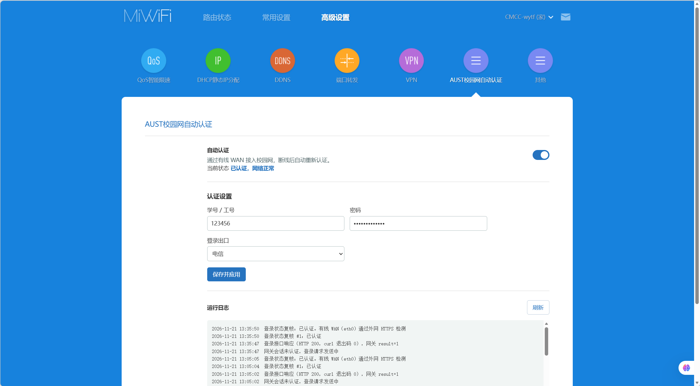

# AUST 校园网自动认证 · 路由器版

在小米路由器上通过有线 WAN 自动认证安徽理工大学校园网，支持账号配置、服务启停、状态查询和日志查看。已在小米固件 6.0.16 验证，其他机型和固件请按实际结构适配。

## 安装前提

路由器需已开启 SSH，并能以 `root` 登录。SSH怎么开启，请参考 [XMiR-Patcher 项目](https://github.com/openwrt-xiaomi/xmir-patcher)。

小米路由器的固件都是使用 OverlayFS，要不是写在/rom分区下的文件，自己写的应用文件和配置在普通重启后都会保留，升级固件或恢复出厂设置将会丢失所有配置。

## 部署模板

`files/` 下的相对路径对应实测路由器上的部署路径。其他固件上的 LuCI 和服务入口按实际结构调整。

| 文件 | 路由器上的参考路径 | 用途 |
| --- | --- | --- |
| `austnet.lua` | `/austnet/austnet.lua` | 守护进程，检测有线 WAN、登录校园网并复查状态 |
| `core.lua` | `/austnet/core.lua` | 公共模块，读写配置、状态和日志 |
| `web.lua` | `/austnet/web.lua` | 管理接口，返回配置和状态，处理保存及服务启停 |
| `austnet.htm` | `/austnet/austnet.htm` | 管理页面，包含配置表单、状态和日志 |
| `config.example.json` | `/austnet/config.json` | 空白配置示例，首次安装时复制为正式配置，升级时保留已有配置 |
| LuCI 控制器 `austnet.lua` | `/usr/lib/lua/luci/controller/austnet.lua` | 注册管理页面和数据接口 |
| `menu-item.htm` | `/usr/lib/lua/luci/view/web/inc/menu-item.htm` | 菜单片段，由固件管理页面引用 |
| 启动脚本 `austnet` | `/etc/init.d/austnet` | 交给 procd 管理守护进程和开机启动 |

实测固件的 LuCI 模板入口为 `/usr/lib/lua/luci/view/web/setting/austnet.htm`，它是指向 `/austnet/austnet.htm` 的软链接。运行状态和日志由程序写入 `/tmp/austnet/`。

可以把本说明、路由器的 SSH 连接信息和 `files/` 交给能访问设备的 AI 。它先检查固件布局和服务机制，备份将修改的文件，再接入页面、菜单和服务，最后验证页面访问及服务启停。
